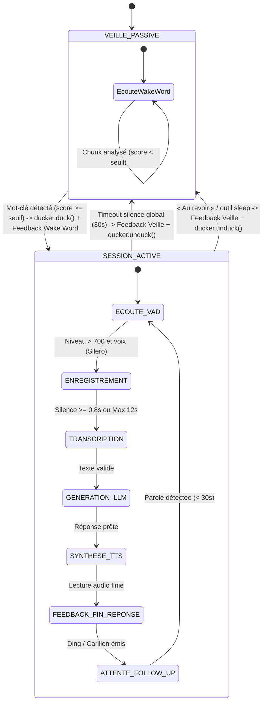

# 🤖 Guide d'Architecture & Directives pour Agents — SmartHome

Ce document est destiné aux agents IA (et aux développeurs) qui lisent, maintiennent, optimisent ou étendent le code du projet **SmartHome**.

---

## 🎯 1. Vision & Philosophie du Projet

**SmartHome** est un assistant vocal domotique conçu avec les principes suivants :
1. **100% Local & Souverain** : Aucune donnée audio ou textuelle ne doit transiter par des serveurs tiers ou le cloud.
2. **Faible Latence (Temps Réel)** : Le pipeline audio de bout en bout (Détection -> STT -> LLM -> TTS) est optimisé pour une réponse rapide et naturelle.
3. **Modularité Découplée** : Chaque étape du pipeline réside dans un module autonome, testable individuellement via son propre point d'entrée CLI.
4. **Continuité Conversationnelle** : Gestion d'une session de dialogue active (follow-up) pour éviter d'imposer à l'utilisateur de répéter le mot-clé à chaque échange.

---

## 📐 2. Cartographie Technique des Composants

```
┌─────────────────────────────────────────────────────────────────────────────────────────────────────────────────────────┐
│                                                         main.py                                                         │
│                                            (Orchestrateur & Machine à États)                                            │
└────────┬───────────────────┬───────────────────┬───────────────────┬───────────────────┬───────────────────┬────────┘
         │                   │                   │                   │                   │                   │
         ▼                   ▼                   ▼                   ▼                   ▼                   ▼                   ▼
┌─────────────────┐ ┌─────────────────┐ ┌─────────────────┐ ┌─────────────────┐ ┌─────────────────┐ ┌─────────────────┐ ┌─────────────────┐
│ audio/wakeword  │ │audio/transcribe │ │     llm/llm     │ │    audio/tts    │ │ audio/feedback  │ │  audio/ducking  │ │    actions/     │
│  (openWakeWord) │ │ (faster-whisper)│ │ (Ollama/Router) │ │   (Piper TTS)   │ │ (Sons & Signaux)│ │(PipeWire/Pulse) │ │ (Modules & OS)  │
└────────┬────────┘ └────────┬────────┘ └────────┬────────┘ └────────┬────────┘ └────────┬────────┘ └────────┬────────┘ └────────┬────────┘
         │                   │                   │                   │                   │                   │                   │
         └───────────────────┴───────────────────┴─────────┬─────────┴───────────────────┴───────────────────┴───────────────────┘
                                                           ▼
                                           ┌───────────────────────────────┐
                                           │          core/config          │
                                           │   (Chargeur .env & Typage)    │
                                           └───────────────────────────────┘
```


### 2.1 [main.py](file:///home/suissard/PROGRAMMATIONS/SmartHome/main.py) — Orchestrateur Principal
- **Responsabilité** : Satellite local : flux micro partagé (`PyAudio`), wake word, ducking, feedbacks et lecture de la voix. Le traitement (LLM, outils, actions) est délégué à `AssistantCore` (session persistante `"local"`, confirmation vocale). Démarre la passerelle en arrière-plan si `GATEWAY_ENABLED=true`, sur le même cœur. Affiche les fournisseurs actifs au démarrage.
- **Paramètres Clés** :
  - `FOLLOW_UP_TIMEOUT` (configurable via `.env`) : Durée (en secondes) pendant laquelle l'assistant reste en écoute active après une réponse. La barre d'écoulement s'adapte dynamiquement à cette durée.
- **Cycle de Fonctionnement** :
  1. Écoute passive par paquets (`CHUNK = 1280` à `RATE = 16000`).
  2. Si le mot-clé est validé (`score > threshold`), atténuation audio globale via `ducker.duck()`, notification `feedback.on_wakeword_detected()`, puis passage en mode `in_conversation = True`.
  3. Boucle de follow-up : appel de `transcriber.record_and_transcribe(...)`.
  4. Si du texte (ou de l'audio en mode direct) est reçu : `run_local_turn()` lance `core.respond("local", on_sentence=speech.say)` dans un thread ; chaque phrase est prononcée dès qu'elle est générée (`SpeechPipeline`) pendant que le thread principal continue de lire le micro (`mic_lock` partagé avec la confirmation vocale) pour détecter une interruption (`BargeInDetector`). Interruption → `core.cancel()` + `speech.interrupt()` + son `BARGE_IN_SOUND`, et écoute immédiate ; sinon signal de fin de tour `feedback.on_response_end()`.
  5. Si timeout de silence : notification de mise en veille `feedback.on_timeout()`, purge du flux, restauration du son système via `ducker.unduck()`, et retour en veille passive.
  6. **Fin de conversation demandée** (`reply.end_conversation`) : même retour en veille, sans attendre le timeout. Déclenchée par une phrase de `CONVERSATION_END_PHRASES` (énoncé entier, aux mots `CONVERSATION_END_FILLERS` près : traitée par `AssistantCore` sans appeler le LLM) ou par l'outil `sleep` / tag `[SLEEP]` ([actions/modules/sleep.py](file:///home/suissard/PROGRAMMATIONS/SmartHome/actions/modules/sleep.py)) que le LLM choisit pour les formulations libres. L'événement `response` porte `end_conversation` (la PWA affiche « Conversation terminée »).

### 2.2 [actions/](file:///home/suissard/PROGRAMMATIONS/SmartHome/actions) — Système Modulaire de Commandes & Actions OS
- **Responsabilité** : Détection des tags d'actions insérés par le LLM (`[SHUTDOWN]`, `[REBOOT]`, `[LOCK]`, `[VOLUME]`, `[MUTE]`, `[OPEN]`, etc.), exécution asynchrone non-bloquante et purification du texte transmis à la synthèse vocale.
- **Architecture Modulaire & Auto-Découverte** :
  - `actions/base.py` : Classe de base abstraite `BaseAction` encapsulant métadonnées, script bash embarqué (`script_code`) et méthode `execute()`.
  - `actions/modules/*.py` : Modules d'actions 100% autonomes (`volume.py`, `media.py`, `notify.py`, `open_app.py`, `lock.py`, `screen_off.py`, `shutdown.py`, `reboot.py`, `sleep.py`, `brightness.py`, `screenshot.py`, `timer.py`, `system_info.py`, `close_app.py`, `audio_output.py`).
  - `actions/registry.py` : Chargeur dynamique avec auto-découverte des définitions sans couplage.
  - `actions/manager.py` : Moteur d'extraction regex générique et d'exécution asynchrone déléguée sans logique en dur (mode tags, repli des modèles sans function calling).
- **Exposition au LLM** : chaque action devient aussi un outil de function calling (`tool_name`, schéma `parameters`) et déclare `danger` (`"safe"` ou `"confirm"` pour SHUTDOWN / REBOOT).

### 2.2 bis [core/tools.py](file:///home/suissard/PROGRAMMATIONS/SmartHome/core/tools.py) & [audio/confirm.py](file:///home/suissard/PROGRAMMATIONS/SmartHome/audio/confirm.py) — Registre d'Outils Unifié & Confirmation
- **Registre** : `build_tool_registry()` réunit les actions locales et les outils des serveurs MCP connectés (schéma JSON, danger, exécuteur). Le propre serveur MCP de SmartHome est ignoré (doublons), ainsi que tout serveur marqué `"expose_to_llm": false` dans `mcp_servers.json`.
- **Danger des outils MCP** : `"tool_danger": "safe" | "confirm"` dans la config du serveur, sinon déduit des annotations MCP (`read_only_hint` / `destructive_hint` ; sans annotation → `confirm`, conformément à la spécification).
- **Politique de confirmation unique** : `request_confirmation()` est appelée pour tout outil ou tag `confirm`. `main.py` installe `VoiceConfirmer` (question TTS, écoute, mots `ACTIONS_CONFIRM_WORDS` / `ACTIONS_CANCEL_WORDS`, ou classification par le LLM en mode STT direct). Sans gestionnaire installé (serveur MCP), l'action est refusée.

### 2.3 [audio/wakeword.py](file:///home/suissard/PROGRAMMATIONS/SmartHome/audio/wakeword.py) — Détection de Mot-Clé
- **Technologie** : `openwakeword` avec moteur d'inférence ONNX Runtime.
- **Format Audio requis** : `RATE = 16000` Hz, 1 canal (mono), `FORMAT = paInt16`, `CHUNK = 1280` échantillons (80 ms par trame).
- **Fonctionnement** :
  - `process_chunk(audio_chunk)` injecte la trame dans le buffer prédictif d'OpenWakeWord.
  - Si le score dépasse `threshold` (par défaut `0.5`), le buffer interne est purgé via `self.oww.reset()` pour éviter les détections fantômes consécutives.

### 2.4 [audio/transcribe.py](file:///home/suissard/PROGRAMMATIONS/SmartHome/audio/transcribe.py) & [audio/stt.py](file:///home/suissard/PROGRAMMATIONS/SmartHome/audio/stt.py) — Enregistrement & STT
- **Technologie** : `transcribe.py` gère uniquement l'enregistrement micro et la VAD ; la transcription est déléguée au fournisseur `STTProvider` choisi par `STT_PROVIDER` dans le registre `STT_PROVIDERS` de `stt.py` (`whisper` via `faster-whisper`, `openrouter` via `/audio/transcriptions`, ou `direct` — alias `none`/`bypass` — pour le bypass STT vers LLM multimodal). `create_stt()` repasse sur Whisper si le LLM ne gère pas l'audio (`supports_audio`).
- **Gestion VAD & Audio** :
  - `pre_buffer` (`deque(maxlen=4)`) : Conserve les 4 dernières trames (320 ms) pour ne jamais couper l'attaque de la voix.
  - **VAD** ([audio/vad.py](file:///home/suissard/PROGRAMMATIONS/SmartHome/audio/vad.py), `SpeechDetector`) : `VAD_ENGINE=silero` (réseau Silero fourni par openWakeWord, local, ~0,3 ms/trame). Début de parole = niveau > `VOICE_THRESHOLD` **et** probabilité de voix ≥ `VAD_SPEECH_THRESHOLD` ; la fin de phrase suit la probabilité de voix (hystérésis), si bien qu'un bruit continu (ventilateur, musique) ne prolonge plus l'enregistrement jusqu'à `MAX_SPEECH_DURATION`. `VAD_ENGINE=energy` = ancien seuil de niveau seul.
  - Un enregistrement contenant moins de `VAD_MIN_SPEECH_DURATION` de parole n'est pas transcrit. Durées mesurées en temps audio (trames lues).
  - `silence_duration = 0.8s` : Seuil de silence consécutif marquant la fin naturelle d'une phrase.
  - **Anti-hallucinations** : `WHISPER_VAD_FILTER` (VAD intégrée à faster-whisper) et `STT_IGNORED_PHRASES` (« Sous-titres réalisés par… », transcriptions sans mot) appliqués par `STTProvider._discard_hallucination()`.
  - `_flush_stream()` : Purge le buffer résiduel de la carte son avant chaque écoute pour éliminer les bruits résiduels ou l'écho de la synthèse précédente.
- **Conversion & Transcription** : Assemblage des trames dans un buffer WAV en mémoire (`io.BytesIO`). Si `STT_PROVIDER=none` ou `direct`, retourne directement les octets WAV sans charger ni appeler de moteur STT. Sinon, effectue la transcription via Whisper local ou OpenRouter.

### 2.5 [llm/llm.py](file:///home/suissard/PROGRAMMATIONS/SmartHome/llm/llm.py) & [llm/providers.py](file:///home/suissard/PROGRAMMATIONS/SmartHome/llm/providers.py) — Raisonnement & Génération
- **Technologie** : `providers.py` définit l'interface `LLMProvider.chat(messages, ...)` et ses implémentations (`ollama` en local, `openrouter` via l'API OpenAI compatible), sélectionnées par `LLM_PROVIDER`. `llm.py` contient la classe `Conversation` (historique, prompt système, streaming console) et les fonctions de compatibilité (`ask_llm`, `get_history`...).
- **Appel d'Outils** (`LLM_TOOL_CALLING`) : `native` (function calling, boucle outil → résultat → LLM jusqu'à `LLM_MAX_TOOL_ROUNDS`), `tags` (`[VOLUME 40]` dans le texte), ou `auto` (natif, repli définitif sur les tags si le modèle lève `ToolsNotSupportedError`). Chaque fournisseur formate ses messages d'outils (`assistant_message`, `tool_message`).
- **Historique Conversationnel** : Maintient un buffer glissant des $N$ derniers messages (`LLM_HISTORY_MESSAGES`, par défaut 5) pour préserver le contexte des échanges récents. Fournit `get_history()`, `clear_history()`, et `add_history_message()`.
- **Support Multimodal Audio Direct** : Fonction `ask_llm(prompt=..., audio_bytes=...)` capable d'envoyer l'audio encodé en base64 via `input_audio` aux modèles multimodaux (ex: Gemini Flash, Voxtral).
- **Prompt Système Dynamique** : Reçoit automatiquement les définitions de commandes d'`ActionManager` pour permettre au LLM d'agir sur le système.
- **Streaming** : Supporte le streaming console immédiat pour un retour visuel en temps réel pendant la génération quel que soit le fournisseur actif.
- **Modèles de Décision** ([llm/decision.py](file:///home/suissard/PROGRAMMATIONS/SmartHome/llm/decision.py)) : un modèle listé dans `LLM_DECISION_MODELS` (ex: `nimble`, endpoint Ollama `/v1/systemone`, `LLMProvider.decide()`) ne rédige pas : `Conversation.ask()` délègue à `run_decision()`, qui pose une question fermée « quelle commande ? » (outils + « aucune », seuil `LLM_DECISION_MIN_CONFIDENCE`), puis une question par argument (choix `BaseAction.decision_choices()`, `enum`, booléen, petite échelle d'entiers ; un outil à argument requis libre n'est pas proposé), exécute l'outil (confirmation comprise) et renvoie une phrase de confirmation : `LLM_DECISION_MESSAGES[outil]` (JSON dans `.env`), sinon `BaseAction.done_message`, sinon la réponse type (`LLM_DECISION_DONE_TEMPLATE`, `_NO_ARGS_TEMPLATE`, `REFUSED_TEMPLATE`, `UNKNOWN_TEXT`). Gabarits `string.Template` : `${COMMAND}`, `${ARGS}`, `${OUTPUT}`, `${TOOL}`, `${<ARGUMENT>}` (le `.env` est lu sans interpolation de variables). `LLMProvider.list_models()` liste les modèles et leurs capacités pour l'interface web.

### 2.6 [audio/tts.py](file:///home/suissard/PROGRAMMATIONS/SmartHome/audio/tts.py) — Synthèse Vocale
- **Technologie** : Fournisseurs `TTSProvider` (`piper` via ONNX neural local ou `openrouter` via `/audio/speech`) sélectionnés par `TTS_PROVIDER`. La façade `TextToSpeech` sépare `synthesize()` (audio post-traité, sans lecture — utilisable pour un client distant) de `speak()` (synthèse + lecture locale).
- **Post-Traitement Audio Anti-Pops & Fluidité** :
  1. *Ponctuation forcée* : Ajout automatique d'un point final si manquant pour garantir une intonation descendante naturelle.
  2. *Fade-Out (50 ms)* : Atténuation linéaire en fin de signal pour supprimer les clics numériques de fin de flux.
  3. *Padding de silence* : Insertion de 100 ms de silence en début de buffer et 400 ms en fin de buffer.
  4. *Lecture synchrone* : Exécution via `sounddevice` (`sd.play` + `sd.wait`).

### 2.6 bis [audio/speech.py](file:///home/suissard/PROGRAMMATIONS/SmartHome/audio/speech.py), [core/sentences.py](file:///home/suissard/PROGRAMMATIONS/SmartHome/core/sentences.py) & [audio/barge_in.py](file:///home/suissard/PROGRAMMATIONS/SmartHome/audio/barge_in.py) — Parole en Streaming & Barge-in
- **Découpage** : `SentenceSplitter` valide une fin de phrase seulement quand le caractère suivant est connu (« 40.5 » jamais coupé), regroupe les morceaux trop courts (`TTS_STREAM_MIN_CHARS`) et retire les tags d'actions.
- **SpeechPipeline** : deux threads (synthèse de la phrase suivante pendant la lecture de la précédente), `interrupt()` vide la file et coupe le son, `close()` arrête les threads. Le « sink » joue localement ou envoie l'audio à un client (passerelle : événements `audio_chunk`).
- **Annulation** : chaque session a un `cancel` (`core.cancel(session)`) vérifié à chaque fragment généré ; `ResponseInterrupted` interrompt la génération sans rien garder dans l'historique (événement `interrupted`).
- **Barge-in** (`BARGE_IN_MODE`) : `wakeword` (redire le mot-clé, robuste à l'écho), `voice` (voix forte continue, avec casque ou annulation d'écho), `off`. Côté PWA, toucher le micro ou envoyer un message pendant une réponse coupe la voix et envoie `{"type": "stop"}`.

### 2.7 [audio/feedback.py](file:///home/suissard/PROGRAMMATIONS/SmartHome/audio/feedback.py) — Sons & Signaux Vocaux de Cycle de Vie
- **Technologie** : Synthèse harmonique procédurale (`numpy` + `sounddevice`) & lecteur WAV.
- **Rôle** : Gère les retours sonores (bips, carillons, accords ascendants/descendants, ding) et vocaux (phrases TTS) pour la détection du wake word, la fin de parole de l'IA et le timeout d'écoute active.

### 2.8 [audio/ducking.py](file:///home/suissard/PROGRAMMATIONS/SmartHome/audio/ducking.py) — Atténuation Audio Système (Ducking)
- **Technologie** : `pactl` JSON (compatible PipeWire & PulseAudio).
- **Rôle** : Réduit le volume de toutes les applications tierces (musique, vidéos, jeux, etc.) à un niveau paramétrable (ex: 20%) dès que l'assistant écoute ou parle, et rétablit les volumes initiaux à la mise en veille. Filtre le PID de l'assistant pour ne pas altérer la voix de sortie.

### 2.9 [core/config.py](file:///home/suissard/PROGRAMMATIONS/SmartHome/core/config.py) & [core/providers.py](file:///home/suissard/PROGRAMMATIONS/SmartHome/core/providers.py) — Configuration & Registre de Fournisseurs
- **Technologie** : modèle `pydantic` `Settings` (validé au démarrage, erreurs lisibles) + `python-dotenv`. Priorité : variables d'environnement > `.env` (ou fichier désigné par `SMARTHOME_ENV_FILE`) > valeurs par défaut. Le nouveau code reçoit `get_settings()` par injection ; les constantes de module restent exportées pour compatibilité.
- **Registre** : `ProviderRegistry` associe un nom (et ses alias) à une classe instanciée avec `Settings`. Chaque fournisseur expose `describe(settings)` (résumé sans instanciation), utilisé par `main.py` et le serveur MCP.
- **Rôle** : Charge `.env` avec conversion de types stricte (`int`, `float`, `bool`, `str`, `Optional`) et fallbacks par défaut pour toutes les constantes du projet (providers LLM/STT/TTS, OpenRouter, audio, wake word, whisper, ollama, piper, feedbacks, ducking, actions, serveur MCP).

### 2.9 bis [core/assistant.py](file:///home/suissard/PROGRAMMATIONS/SmartHome/core/assistant.py) & [core/events.py](file:///home/suissard/PROGRAMMATIONS/SmartHome/core/events.py) — Cœur de Service & Bus d'Événements
- **AssistantCore** : indépendant des entrées/sorties. Partage un fournisseur LLM, un STT, un TTS et un registre d'outils entre des **sessions** (conversation, historique, gestionnaire de confirmation et verrou propres ; expiration après `GATEWAY_SESSION_TIMEOUT`, sauf sessions persistantes). `respond(session, text|audio_wav, synthesize)` exécute le pipeline complet (bloquant, à appeler via `asyncio.to_thread` côté serveur) et renvoie un `Reply`.
- **EventBus** : publie `transcript`, `token`, `tool`, `confirm_request`, `response`, `error`, `settings_changed` (abonnement global ou par session, thread-safe). La console de `main.py` et chaque client WebSocket sont des abonnés.
- **Paramètres à chaud** ([core/settings_store.py](file:///home/suissard/PROGRAMMATIONS/SmartHome/core/settings_store.py)) : `EDITABLE_GROUPS` liste les champs modifiables depuis l'interface (jamais les secrets ni l'exposition réseau), avec leur prise d'effet (immédiate ou au redémarrage) ; l'aide affichée vient des commentaires de `.env.example`. `AssistantCore.update_settings()` valide, réécrit les lignes concernées de `.env` (commentaires conservés), remplace la configuration courante (`config.set_settings`) et met à jour toutes les sessions (historique conservé). Les constantes de module de `config.py` gardent leur valeur de démarrage : un champ lu par `main.py`, le micro ou la voix doit être marqué `RESTART`.

### 2.9 ter [gateway/](file:///home/suissard/PROGRAMMATIONS/SmartHome/gateway) — Passerelle Réseau (LAN / Tailscale)
- **Technologie** : Starlette + uvicorn. `GET /health`, `POST /api/ask` (sans confirmation possible : actions dangereuses refusées), `WS /ws` (protocole JSON décrit en tête de `gateway/app.py` : streaming, outils, confirmations aller-retour, voix WAV en base64).
- **Sécurité** (`core/security.py`, partagé avec le serveur MCP) : jeton `GATEWAY_AUTH_TOKEN` (en-tête Bearer, ou premier message `auth` pour les navigateurs), refus de démarrer hors loopback sans jeton.
- **Lancement** : dans `main.py` (`GATEWAY_ENABLED=true`) ou seul, sans micro : `python -m gateway`. Client de test : `python -m gateway.client`.
- **Interface web / PWA** (`gateway/web/`, servie à la racine, publique car sans secret) : HTML/CSS/JS sans dépendance ni build. `app.js` (WebSocket, streaming, puces d'outils, confirmation avec compte à rebours, lecture de la voix, choix du modèle Ollama et case « modèle de décision », formulaire « Paramètres avancés » généré d'après `settings_store.describe()`), `recorder.js` + `recorder-worklet.js` (capture micro AudioWorklet, fin de phrase avec les seuils `VOICE_THRESHOLD`/`SILENCE_DURATION` transmis dans le message `ready`, rééchantillonnage 16 kHz et encodage WAV dans le navigateur), `sw.js` (cache réseau d'abord du squelette uniquement). Le micro exige le HTTPS hors localhost : `tailscale serve --bg 8765`.
- **Durcissement** : `SecurityHeadersMiddleware` (CSP stricte : aucun script inline ni ressource externe) et `LocalOnlyMiddleware` (sans jeton, toute requête relayée par un proxy — `X-Forwarded-For`, `Tailscale-User-Login` — est refusée).

### 2.10 [mcp_server.py](file:///home/suissard/PROGRAMMATIONS/SmartHome/mcp_server.py) — Serveur MCP (Model Context Protocol) Universel
- **Technologie** : `mcp.server.mcpserver.MCPServer` (MCP 2.x).
- **Rôle** : Expose l'intégralité des briques logiques et physiques sous forme de standard MCP :
  - **Tools (16 outils)** : `execute_action`, `list_actions`, `set_volume`, `media_control`, `send_notification`, `open_application`, `lock_session`, `screen_off`, `system_power`, `tts_speak`, `play_feedback_sound`, `set_system_ducking`, `stt_transcribe_file`, `ask_assistant`, `get_conversation_history`, `clear_conversation_history`.
  - **Resources (4 ressources)** : `smarthome://status`, `smarthome://actions`, `smarthome://history`, `smarthome://config`.
  - **Prompts (2 prompts)** : `smarthome_assistant`, `smart_home_planner`.
  - **Multi-Transport** : Supporte `stdio` (local pour Claude Desktop, Cursor, Antigravity) et `sse`/`streamable-http` (accessible sur le réseau local ou distant).


---

## 🔄 3. Diagramme de la Machine à États



---

## 🛠️ 4. Directives de Développement & Règles pour les Agents

Lors de toute intervention sur ce codebase, veillez à respecter les règles suivantes :

### 1. Préservation des Points d'Entrée de Test Autonomes
Chaque module Python (`config.py`, `wakeword.py`, `transcribe.py`, `stt.py`, `llm.py`, `providers.py`, `tts.py`, `speech.py`, `barge_in.py`, `vad.py`, `sentences.py`, `feedback.py`, `ducking.py`, `confirm.py`, `tools.py`, `events.py`, `assistant.py`, `decision.py`, `settings_store.py`, `test_sound.py`) **doit impérativement conserver son bloc `if __name__ == "__main__":`**. Ces blocs permettent un diagnostic isolé sans charger toute la pile applicative.


### 2. Gestion des Flux Audio & Synchronisation
- **Attention au Microphone Lock** : L'objet `stream` (`pyaudio.Stream`) est partagé entre la détection de wake word et le transcripteur. Veillez à ne pas ouvrir plusieurs flux concurrents sur le même device audio sous Linux (risque de conflit ALSA/PulseAudio).
- **Purge de Buffer** : Toujours appeler `_flush_stream()` après une synthèse vocale ou avant un nouvel enregistrement pour éviter de réinjecter l'écho du TTS dans le STT.

### 3. Gestion des Modèles & Formats
- Les modèles de mot-clé doivent être placés dans le dossier `wakewords/` et chargés sous forme de fichiers ONNX compatibles avec OpenWakeWord.
- Pour Whisper, privilégiez `device="cpu"` et `compute_type="int8"` pour garantir une compatibilité universelle sur tout CPU moderne sans surcharger la mémoire vidéo du LLM.

### 4. Ajout d'un Fournisseur (LLM / STT / TTS)
- Créer une classe héritant de `LLMProvider`, `STTProvider` ou `TTSProvider`, prenant `settings: Settings` en constructeur, et la décorer avec `@LLM_PROVIDERS.register("nom")` (resp. `STT_PROVIDERS`, `TTS_PROVIDERS`).
- Importer les dépendances lourdes dans le constructeur (chargement paresseux), lever une exception en cas d'échec (l'appelant la convertit en message ⚠️), et ne jamais ajouter de `if PROVIDER == ...` ailleurs dans le code.

### 5. Centralisation des Variables & Configuration
- **Aucune variable de paramétrage ne doit être écrite en dur** directement dans les fonctions ou classes.
- Déclarez toujours les nouvelles variables dans `.env.example`, `.env` et comme champ typé (avec valeur par défaut et contraintes) du modèle `Settings` de `config.py`.


---

## 🚀 5. Roadmap Technique & Perspectives d'Évolution

Pour les futures évolutions du projet, les axes prioritaires sont :

1. **Intégration Domotique (Home Assistant)** :
   - Le *Function Calling* est en place (`core/tools.py`) : activer le serveur MCP Home Assistant dans `mcp_servers.json` suffit pour que ses outils soient proposés au LLM.
2. **Streaming Pipeline** : ✅ en place (parole phrase par phrase, ~2 s gagnées avant la première parole).
3. **Barge-in / Annulation d'Écho Acoustique (AEC)** :
   - ✅ Interruption par mot-clé (local) et par le bouton micro (PWA).
   - Reste : barge-in « à la voix » sans casque, via le module PipeWire `echo-cancel` comme source micro.
4. **Multi-room / MQTT Audio Satellite** :
   - Déporter la capture audio vers des satellites ESP32 / Raspberry Pi via protocole léger (ex: Wyoming / MQTT).
